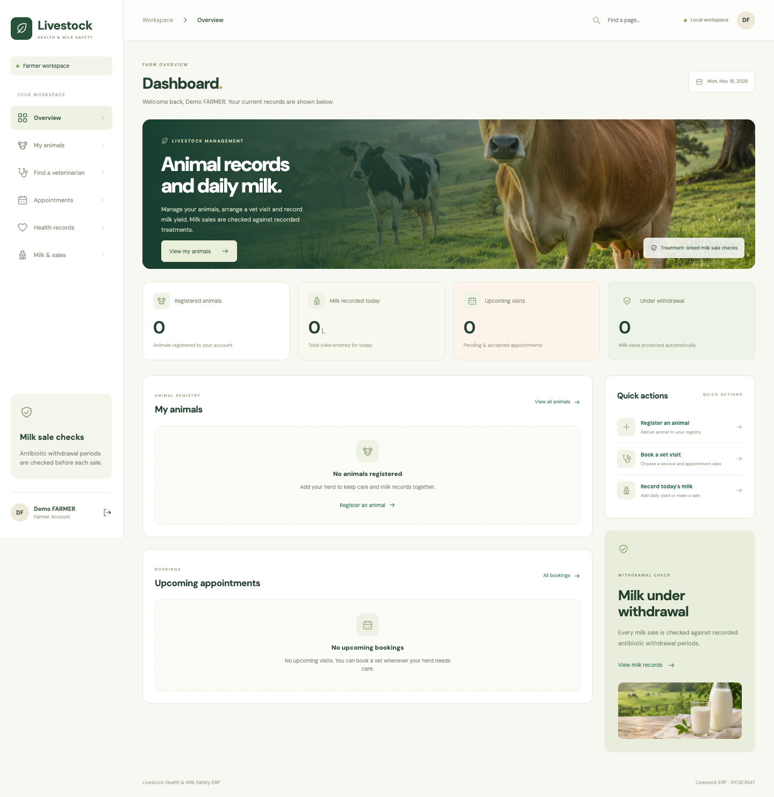
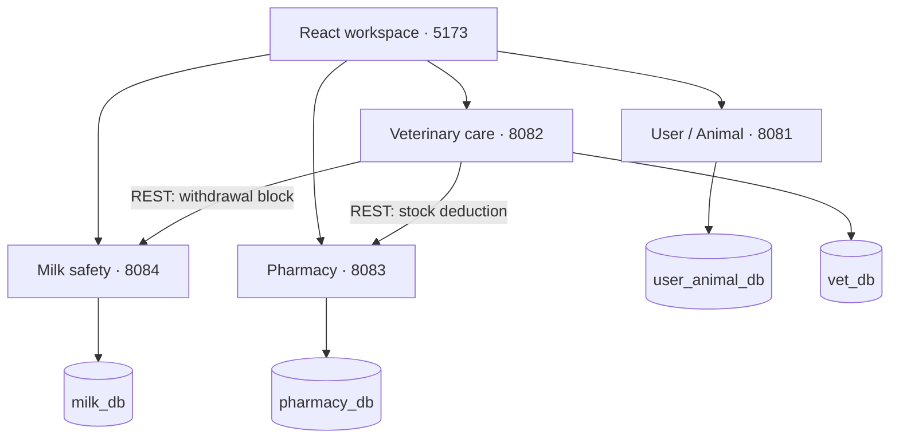

# Livestock Health & Milk Safety ERP

A project for **21CSE354T — Full Stack Web Development**.

A full-stack academic ERP that links veterinary treatment records to milk-sale safety checks. Built with **React**, **Java 17**, **Spring Boot 3**, and **MySQL**, with four independently runnable REST microservices.



[Features](#features) · [Architecture](#architecture) · [Run locally](#run-locally) · [Testing](#testing) · [API reference](docs/API.md) · [Viva guide](docs/VIVA.md)

## Problem and approach

Animal care and milk sales are often recorded separately. This project connects them: recording an antibiotic treatment creates a withdrawal block, and every milk sale checks that block before proceeding.

Milk collected during withdrawal remains excluded from saleable yield even after the block expires. Retry-safe stock deductions help keep medicine inventory consistent when a REST call fails.

## Features

| Role          | Capabilities                                                                                                                                   |
| ------------- | ---------------------------------------------------------------------------------------------------------------------------------------------- |
| Farmer        | Register animals, browse veterinarians, book services, review care history, record daily yield, sell eligible milk, and rate completed visits  |
| Veterinarian  | Create profiles and services, manage availability, accept/reject bookings, record treatments and vaccinations, and resume incomplete workflows |
| Administrator | Manage accounts, update medicine/vaccine inventory, monitor stock thresholds, and explore six SQL reports                                      |

- **Withdrawal-aware sales:** active blocks reject sales with remaining days.
- **Safe-yield accounting:** historical withdrawal milk is excluded; overselling is rejected.
- **Retry-safe stock:** unique request keys and database row locks prevent repeat deductions.
- **Role-aware access:** BCrypt passwords, signed bearer tokens, and principal ownership checks.
- React UI with role-specific dashboards, forms, tables and responsive navigation.
- **Plain JDBC reports:** DriverManager, PreparedStatement, and ResultSet alongside JPA persistence.

## Architecture



Each service follows **Controller → Service → Repository**, with entity/model, DTO, validation, exception handling, and security packages.

Each owns a separate schema. JPA relationships and foreign keys stay within schema boundaries; remote IDs are validated over REST. The schemas share one MySQL instance so the academic JDBC report module can perform cross-schema SELECTs.

| Service             | Port | Responsibility                                                      |
| ------------------- | ---- | ------------------------------------------------------------------- |
| user-animal-service | 8081 | Users, farmer profiles, animals                                     |
| vet-service         | 8082 | Vet profiles, listings, bookings, treatments, vaccinations, ratings |
| pharmacy-service    | 8083 | Inventory, stock movements, JDBC reports                            |
| milk-service        | 8084 | Yield records, sales, withdrawal blocks                             |

## The safety workflow

1. A farmer registers an animal and books a veterinary service.
2. The veterinarian accepts the visit and records a treatment.
3. The system saves processing checkpoints and creates an antibiotic withdrawal block.
4. Pharmacy stock is deducted using an idempotency key.
5. The treatment and booking are marked completed.
6. A milk sale checks ownership, active blocks, and available safe yield.
7. Eligible sales proceed; blocked sales return HTTP 409 with the remaining days.

**Date convention:** the interval is `[treatmentDate, treatmentDate + withdrawalDays]`, including both dates. The animal remains blocked on the end date; sales resume the next day. Effective days cannot be below the medicine inventory's configured minimum.

The block is created before deduction for conservative failure handling. An incomplete workflow can be resumed from treatment history. There is no distributed transaction or automatic rollback across REST services.

## Run locally

### Prerequisites

- Java 17 and Maven 3.9+
- Node.js 22.12+ and npm
- MySQL 8+
- Python 3 for the optional integration checks

### Initialize the database

```bash
mysql -u root -p < database/01-schema.sql
mysql -u root -p < database/02-seed.sql
export DB_USERNAME=root
export DB_PASSWORD='your-local-mysql-password'
```

Alternatively, use the included local database container:

```bash
docker compose up -d mysql
```

The Docker configuration is a **local demonstration setup** with an empty root password. Keep it private and unset DB_PASSWORD for that configuration.

### Build and start

```bash
bash scripts/build.sh
bash scripts/start.sh
```

Open **http://localhost:5173**. Wait for the backends to initialize; logs are written to `logs/`. Ctrl+C stops processes started by the starter script.

You can also run `mvn spring-boot:run` inside each service and `npm ci && npm run dev` inside `frontend/`.

The macOS helper `Start Local ERP.command` starts a project-local persistent MySQL database and the application. See [local startup notes](docs/LOCAL.md) for its platform-specific defaults. Standard Maven/MySQL setup works independently of that helper.

## Demo accounts

| Role   | Email             | Password |
| ------ | ----------------- | -------- |
| Farmer | farmer@demo.local | Demo123! |
| Vet    | vet@demo.local    | Demo123! |
| Admin  | admin@demo.local  | Demo123! |

These are seeded academic accounts for synthetic data. Farmer registration is also available on the login page.

## Testing

The checks cover the main implemented workflows; this is not a production security or load-test audit.

With the services running against MySQL:

```bash
python3 scripts/smoke-test.py
```

Or, after building, use an isolated H2 integration harness:

```bash
bash scripts/test-h2.sh
```

The test launches the same four packaged applications with separate test ports and checks login/authorization, booking, antibiotic treatment, active and expired withdrawal, the inclusive end-date boundary, historical unsafe yield, overselling, stock failure/retry, vaccination, rating, and all six JDBC reports.

For additional validation and simultaneous stock/sale requests, run `python3 scripts/negative-check.py`.

Browser checks require the local ERP to be running:

```bash
cd frontend
npx playwright install chromium
npm run test:ui
```

These exercise role pages, all reports, signup, animal CRUD, inventory editing, session handling, and mobile navigation. They write fresh screenshots under `docs/screenshots/`. Set `CHROMIUM_EXECUTABLE` if using an existing Chromium installation.

The workflow has passed against local **MySQL 8.4.13**, H2 in MySQL mode, and a temporary HTTPS demo tunnel. See the [verification record](docs/VERIFICATION.md). The included GitHub Actions workflow builds the project and runs the H2 integration harness; its first hosted result will be available after publication.

## SQL reports

| Report                                                       | SQL concept                |
| ------------------------------------------------------------ | -------------------------- |
| Animals currently under withdrawal, with farmer and end date | JOIN                       |
| Vets rated above the overall average                         | Subquery, GROUP BY, HAVING |
| Medicines below their stock threshold                        | WHERE                      |
| Farmers with pending bookings or active withdrawal           | UNION                      |
| Treated animals without completed vaccinations               | NOT IN / set difference    |
| Animals both treated and vaccinated                          | IN / set intersection      |

Exact queries: [database/03-reports.sql](database/03-reports.sql). DDL and DML examples use an isolated scratch table.

## Configuration

| Variable                                                         | Purpose                                                                                |
| ---------------------------------------------------------------- | -------------------------------------------------------------------------------------- |
| DB_USERNAME / DB_PASSWORD                                        | Database credentials                                                                   |
| DB_URL                                                           | Optional per-service JDBC URL; normally leave unset to retain separate default schemas |
| AUTH_SECRET                                                      | Token signing secret shared by all services                                            |
| SERVICE_KEY                                                      | Internal request secret shared by all services                                         |
| FRONTEND_ORIGIN                                                  | Allowed frontend origin                                                                |
| USER_URL / PHARMACY_URL / MILK_URL                               | Backend-to-backend REST addresses                                                      |
| VITE_USER_URL / VITE_VET_URL / VITE_PHARMACY_URL / VITE_MILK_URL | Hosted frontend API bases; set before building                                         |

The local Vite server proxies API calls to the four services. A hosted static frontend also requires reachable HTTPS backends; localhost URLs do not work for other visitors.

Temporary demo links expire and depend on the host computer remaining online. No temporary URL is advertised here as permanent hosting.

## Repository map

```text
├── user-animal-service/
├── vet-service/
├── pharmacy-service/
├── milk-service/
├── frontend/
│   ├── src/                 # React views, auth, hooks, forms, icons, styles
│   └── public/              # Local fonts and generated dairy imagery
├── database/                # Schema, seeds, reports, SQL examples
├── scripts/                 # Build, startup, smoke tests, local helpers
├── docs/                    # API, verification, local setup and viva notes
├── .github/workflows/       # Build and integration checks
└── docker-compose.yml
```

## Scope and limitations

This is an academic project for **21CSE354T Full Stack Web Development**. Sample medicines, doses and withdrawal values demonstrate software rules, not veterinary guidance.

Run one instance per service: milk operations currently serialize within one process. Production work would require distributed per-animal locking, migrations, reconciliation, stronger account provisioning, and deliberate time-zone policies. Replace shared demo secrets and accounts before using real data.

## Learning outcomes

HTML/CSS layouts and transitions · React components, hooks and routing · SQL and plain JDBC · Spring Boot layered architecture · Spring Data JPA · REST microservice coordination.

Image provenance is recorded under `frontend/public/images/`. Font licences are included alongside the font files.
